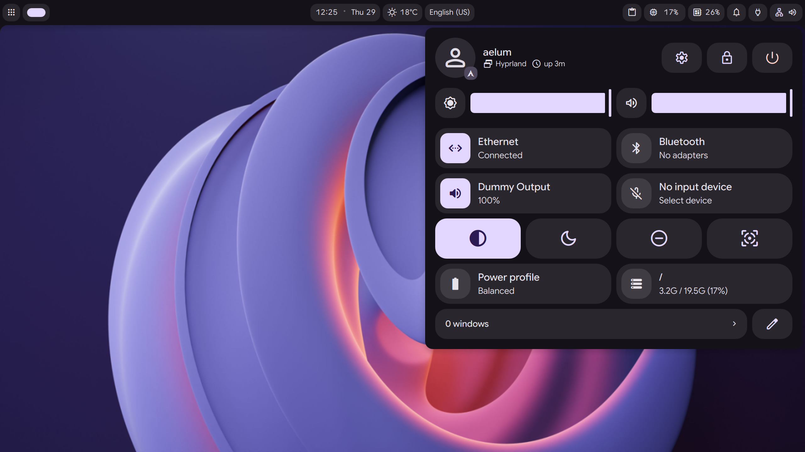

# Aelum

Aelum is an Arch Linux distro whose installer needs no internet: every package it installs is already
inside the ISO. The installer asks four questions — language, user, disk, confirm — and writes a
complete desktop from the stick itself. Once installed it's a normal Arch system: update what you
want, from wherever you want.

This repo is the **live session**. It boots, opens the [installer](https://github.com/aelum-dev/installer),
and stays out of the way. Everything you keep is written by that installer.

## What you get

- Hyprland with Dux Shell, colored to match your wallpaper (matugen)
- Dux Greeter login, Kitty, Firefox with uBlock Origin added on first launch, PipeWire audio
- ext4 or btrfs, with or without LUKS2 — your choice on the disk screen
- zram instead of a swap file, an Aelum boot menu and splash
- about 1.5 minutes to install, and roughly 3.2 GB used on btrfs (4.7 GB on ext4)

Needs UEFI and at least 8 GB of disk. Automatic mode erases the whole disk; manual mode formats only
the two partitions you assign and leaves the rest of your data alone.

## Snapshots, briefly

On a btrfs install, every `pacman` transaction takes a snapshot before and after it. The Aelum entry
in the boot menu lists them — select it and press `F2`. Boot one and the desktop asks, in your
language, whether to make that state the system again; saying yes runs `snapper rollback`.

## Get it

- **Download:** [aelum.dev](https://aelum.dev/download/) — the ISO, its checksums and its signature
- **Build it:** [aelum/docker](https://github.com/aelum-dev/docker) turns this profile into an ISO and
  runs the install tests in QEMU
- **How the install goes:** [aelum.dev/install/](https://aelum.dev/install/)

## Working on this repo

Profile content only — `airootfs/`, package lists, boot configs, the Plymouth and rEFInd themes, the
snapshot-restore prompt. Nothing here builds an ISO. Read `AGENTS.md` first; it holds the parts that
were learned the expensive way.

## License

GPL-3.0 — see `LICENSE`.
