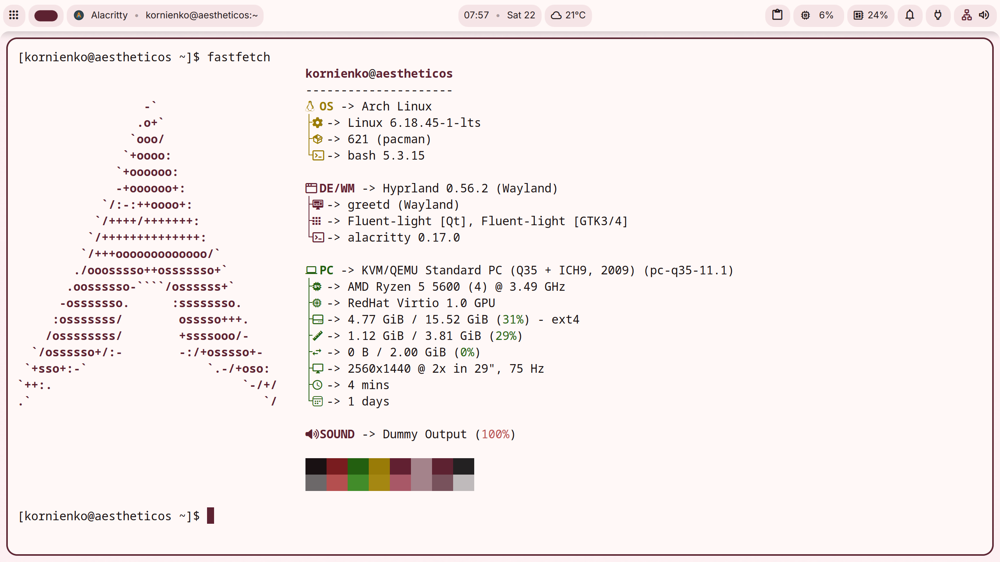

# Aelum



Aelum is an Arch Linux distro with a fully offline installer. The live ISO itself is intentionally barebones — its only job is to boot and launch the [Aelum Installer](https://github.com/aelum-dev/installer). That installer then sets up a complete, polished desktop: [Hyprland](https://hyprland.org/) window management, the Dux Shell + Dux Greeter login, automatic color theming with matugen, and more.

The install itself needs no internet. Every package is cached locally in an embedded repository, so it's completely air-gapped: boot it on any machine, the installer starts on its own, and you don't need a network connection to install it. Once installed, it's a normal Arch system — use the internet, update packages, install whatever you like.

---

## Features

- **Offline install** — every package needed to install is embedded in the ISO, so the install doesn't touch the network. (Once installed, your system works like any Arch install and uses the internet normally.)
- **Auto-launching installer** — on first boot, greetd starts a barebones Hyprland that opens the installer by itself
- **Silent boot** — clean branded Aelum Plymouth splash (with passphrase unlock on encrypted installs), no console spam
- **Auto monitor scaling** — detects the connected monitor and applies the right Hyprland scale automatically, so the installer reads crisply at 1080p, 1440p, or 4K
- **Quick install** — since every package is included, the whole install takes about a minute and a half (68–93 s end to end across the QEMU matrix in `docker/logs/matrix/`), and the finished OS uses roughly 3.2 GB on btrfs (with compression) or 4.7 GB on ext4

## What you install

The installer hands you a finished desktop, pre-configured and ready:

- **Hyprland** dynamic tiling with Dux Shell (Quickshell-based) for a clean, modern look
- **Dux Greeter** (greetd) — a fast login screen
- **matugen** — generates matching color schemes from your wallpaper automatically
- **Kitty**, **Firefox** (with **uBlock Origin** pre-installed), **PipeWire** audio, and a branded **Aelum** Plymouth boot splash (with LUKS passphrase unlock)
- **GTK + Qt apps get matugen-themed automatically**. In Qt apps, just pick the built-in matugen theme and it matches the rest of the system
- **zram** compressed swap — fast, and no disk space reserved for a swap file
- **Snapshots on btrfs** — snapper keeps a timeline of `@` and `@home`, snapshots `@` before and after every pacman transaction, and puts them in a single **Snapshots** entry in the Aelum boot menu (open it with `F2`), so a bad update can be booted past or rolled back (**btrfs-assistant** is the GUI)

## Why Aelum

- **Installs without a network.** No chasing slow or missing mirrors during install — everything is baked into the ISO. Handy on a machine that has no internet at install time. (After install you can connect normally.)
- **A finished desktop, not a blank slate.** You get a curated Hyprland + Dux Shell setup with automatic theming, so it looks reasonable straight after install.
- **Quiet boot.** Silent, branded boot splash, auto monitor scaling, and zram instead of a swap file.
- **Nothing extra.** The live ISO exists to launch the installer, so there's little to configure or clean up.

---

## Project Structure

This repo is the **Aelum profile** — the content that goes into the ISO. The build pipeline that turns it into an ISO now lives in a separate repo: [aelum/docker](https://github.com/aelum-dev/docker). See [Building & Running](#building--running) below.

```
.
├── profiledef.sh          # ISO metadata (name, label, publisher, install dir)
├── packages.x86_64        # Official packages to include
├── packages.aur.x86_64    # AUR packages to build
├── bootstrap_packages     # Packages for the base install environment
├── pacman-offline.conf    # Pacman config used by mkarchiso (offline mirror only)
├── airootfs/              # Root filesystem for the ISO
│   ├── etc/
│   │   ├── greetd/            # greetd + Dux Greeter config (launches installer)
│   │   ├── mkinitcpio.conf.d/ # Live ISO mkinitcpio hooks
│   │   ├── mkinitcpio.d/      # Kernel preset
│   │   ├── pacman.conf        # Installed system pacman config (offline mirror)
│   │   ├── plymouth/          # Plymouth daemon config
│   │   ├── skel/              # Default user home (dotfiles)
│   │   ├── skel/.hushlogin    # Suppress "Last login" message
│   │   ├── systemd/system/    # Systemd units (animation delay, etc.)
│   │   └── sudoers.d/         # Sudo config for aelum user
│   ├── usr/lib/initcpio/             # Live ISO mkinitcpio hooks (aelum-live)
│   └── usr/share/
│       ├── aelum/                      # Aelum brand assets
│       │   ├── refind/themes/aelum/    # Branded rEFInd boot-menu theme
│       │   └── bg-*.png, wallpaper-*.jpg  # live backgrounds + installed wallpapers
│       └── plymouth/themes/aelum/      # LUKS unlock splash theme
├── efiboot/               # systemd-boot EFI boot entries
│   └── loader/entries/
│       └── 01-aelum-linux.conf
├── grub/                  # GRUB (BIOS/UEFI) boot config
├── syslinux/              # Syslinux (BIOS) boot config
└── images/                # Website / README images
```

---

## Building & Running

All building (ISO creation) and running (QEMU testing) of Aelum are done in the [aelum/docker](https://github.com/aelum-dev/docker) repo — not here. Firefox ships with **uBlock Origin** automatically installed on first boot (when online). This is done with a Mozilla distribution policy in `airootfs/usr/lib/firefox/distribution/policies.json`, which force-installs the add-on from [addons.mozilla.org](https://addons.mozilla.org) using its add-on ID (`uBlock0@raymondhill.net`). No add-on file is bundled in the ISO — Firefox downloads it on first launch. See Mozilla's [Deploy Firefox with extensions](https://support.mozilla.org/en-US/kb/deploying-firefox-with-extensions) docs for how this works.

This repo only holds the profile content that goes into the ISO. See the [docker repo README](https://github.com/aelum-dev/docker) for build and run instructions.

---

## Offline Install (No Internet During Install)

All packages needed for the install are cached in `airootfs/var/cache/aelum/offline-mirror/` and served via a `file://` URL in the ISO's pacman.conf, so the install doesn't reach the network. This applies to installation only — the installed system is a regular Arch install and uses the internet for updates and anything else you add.

Because every package is included, **installation takes about a minute and a half** — the matrix logs in `docker/logs/matrix/` run 68–93 s from "Formatting disk" to "Installation completed successfully" on a 20 GB qcow2 in QEMU — and the **complete OS requires roughly 3.2 GB of disk space on btrfs (with compression) or 4.7 GB on ext4** after install.

---

## Networking & DNS

The live ISO uses `systemd-networkd` + `systemd-resolved` (both enabled in
`airootfs/etc/systemd/system/multi-user.target.wants/`). `airootfs/etc/resolv.conf`
**must** be the symlink to `/run/systemd/resolve/stub-resolv.conf` (copied from
the upstream archiso profile), not a regular file.

This matters because not every program resolves names through glibc's NSS
stack: GnuPG's `dirmngr` (and other tools that call `res_query` directly) reads
`/etc/resolv.conf` itself. With a comment-only file — which is what the
`filesystem` package ships when the profile omits the symlink — `getent` and
`curl` still work via `nss-resolve`, but `dirmngr` has no nameserver and fails
with `error retrieving ... via WKD: Server indicated a failure`. Keeping the
symlink makes WKD, `dig`, and every other direct `resolv.conf` consumer work.

---

## Boot Splash Progress (Plymouth)

`airootfs/usr/share/plymouth/themes/aelum/aelum.script` has two progress modes:

- **Installed system** — a timed stand-in bar (cold boot / post-LUKS unlock). Real
  install-time progress is not knowable on Arch, so the timer stays. Because the
  timer cannot know when boot ends, the installer also drops
  `aelum-boot-progress.service` into the target; like the live ISO's unit it
  sends `boot:complete` just before plymouth-quit, pushing the bar to 100%.
  On an **encrypted** install the bar is additionally gated on the passphrase:
  the installer's `aelum-luks-hint` initramfs hook sends `luks:locked` right
  after the splash appears (the bar is held back) and `luks:unlocked` when the
  root volume opens (the bar starts). A rejected passphrase therefore never
  shows boot progress; it shows systemd's own per-volume prompt plus a retry
  message, and the machine powers off once the tries are exhausted. See
  `installer/backend/install/configure/luks_hint.go`.
- **Live ISO** — the bar follows real events. `usr/lib/initcpio/hooks/aelum-live`
  sends `plymouth update --status=live[:STAGE]` for every stage it sees in
  `/proc/mounts` while archiso mounts, and pings `switchroot` immediately before
  `switch_root`. `etc/systemd/system/aelum-live-progress.service` sends the final
  `userspace` milestone immediately before `plymouth-quit.service` dismisses the
  splash. It is ordered `Before=` that unit, and holds the splash for a few
  refresh intervals after sending the status so the 100% frame is actually
  composited — otherwise the status and the quit land a couple of frames apart
  and the bar can get cut short. The stages the theme reacts to are listed in
  the theme's header.

The hook must stay **after `plymouth`** in `HOOKS` (`etc/mkinitcpio.conf.d/archiso.conf`):
it only talks to an already-started `plymouthd`, and its `run_latehook` has to run
after plymouth's. Both halves of the hook are declared in `profiledef.sh` with mode
`0755` — mkinitcpio finds hooks with `type -P`, and mkarchiso does not copy exec bits.

---

## Boot Menu Theme (rEFInd)

The installed system boots through rEFInd, and its menu is branded with the
theme in `airootfs/usr/share/aelum/refind/themes/aelum/`. The installer copies
that directory to `EFI/refind/themes/aelum` on the ESP and pulls it in from
`refind.conf` with `include themes/aelum/theme.conf`, so the boot menu matches
the Plymouth splash and desktop without any network access.

The `refind.conf` written by the installer is global; each Aelum installation
writes its own menu fragment to `EFI/refind/aelum/<id>.conf` and adds an
`include aelum/<id>.conf` line. Kernel and initramfs images are likewise kept
per install in `aelum/<id>/` on the ESP (bind-mounted at `/boot`), and the
fragment loads them from there. This lets two Aelum installs share one ESP
without overwriting each other's boot entry or kernel files.

The theme is a 3840×2160 background using the live ISO's solid dark colour
(`#141218`) with the Aelum lockup at the top, JetBrains Mono glyph sheets
(1× and 2×), a rounded selection highlight, and a complete themed icon set.
`os_arch.png` is the Aelum mark used by Aelum's own menu entries; rEFInd's
auto-detected loaders get their own Nerd Font glyphs on the same cream tile so
they no longer all look alike: the Arch logo for systemd-boot
(`os_systemd.png` and `os_gummiboot.png`), the Windows logo
(`os_win.png`/`os_win8.png`), a USB stick for Ventoy
(`os_ventoy.png`/`os_vtoyefi.png`), Tux for generic Linux/GRUB (`os_linux.png`),
and distro glyphs for the rest of rEFInd's stock OS names.
The theme also overrides rEFInd's stock tools, functions, volume badges,
arrows, mouse, and boot logos, so the stock artwork is never used: the tools
row is light glyphs on transparency and volume badges are cream glyphs in a
plum circle. Icons and selections are generated at 2×: rEFInd doubles icon
sizes at screen widths of 1921px or more, so the 256px OS icons are native on
2K/4K and downscaled on 1080p; the 96px tool glyphs, 64px volume badges, and
32px mouse are likewise 2× assets. rEFInd does not scale custom fonts, so the
installer selects `font-2x.png` whenever the chosen mode is at least 1921px
wide (2K, 4K, ultrawide). The font glyphs are intentionally black in the PNG —
rEFInd inverts them on a dark background to render the menu text white. OS
icon glyphs are drawn in the plum accent on cream tiles; small icons use the
light text color. The binaries are generated by `scripts/gen-refind-theme.py`
from the live ISO dark background, the Plymouth logo, the brand palette, and the
Nerd Font Symbols source shared with the website; re-run it after changing any
of them, then commit the rebuilt PNGs:

```bash
# Full theme (background, fonts, selections, icons)
python3 scripts/gen-refind-theme.py

# Icons only, while iterating on the glyph set
python3 scripts/gen-refind-theme.py --icons-only
```

The icon-only mode needs `website/scripts/SymbolsNerdFont-Regular.ttf`; if the
repos are not side by side, set `AELUM_NERD_FONT` to the TTF path.

---

## GPU Support (Early KMS)

The live initramfs carries the kernel's DRM/KMS drivers, so the panel switches
to its native GPU mode before `plymouth` and the desktop start (no low-res
`simpledrm` hand-off, no mode-set flicker). This is done with the `kms` hook in
`airootfs/etc/mkinitcpio.conf.d/archiso.conf`:

- **AMD** — `amdgpu`, `radeon`
- **Intel** — `i915`, `xe`
- **NVIDIA** — `nouveau` (the ISO ships no proprietary driver)
- **VMs** — `virtio_gpu`, `vmwgfx`, and the other DRM drivers

The live ISO intentionally has no `autodetect` hook, so the image must boot on
any machine: `kms` includes every DRM module, and `udev` loads only the one
matching the detected hardware. The installed system uses `autodetect` + `kms`
(see the installer's `configureInitramfs`), so its initramfs is trimmed to the
machine it was installed on.

---

## License

Released under the [GNU General Public License v3.0 (GPL-3.0)](https://www.gnu.org/licenses/gpl-3.0.html). See the `LICENSE` file for the full text.
